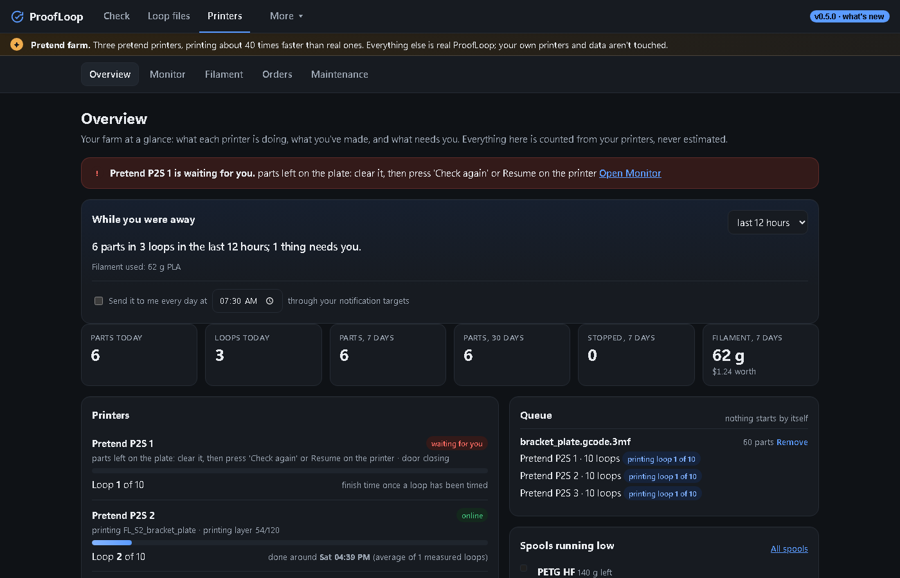
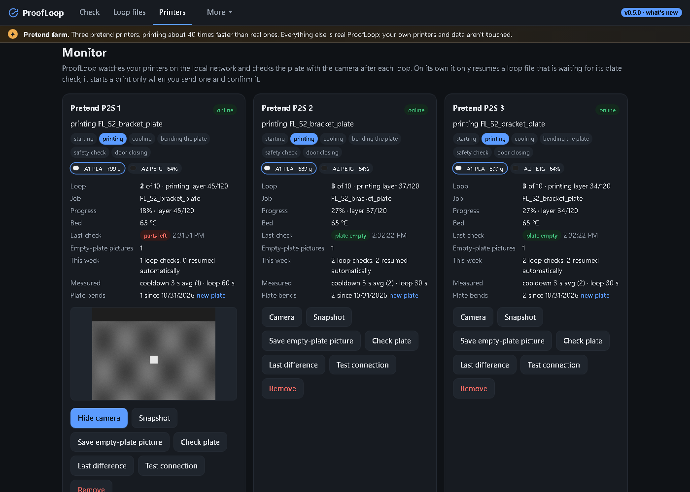
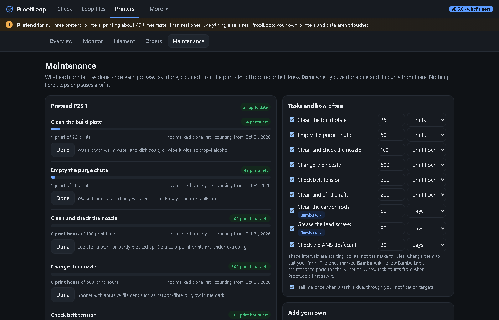

# ProofLoop

**Proof your designs. Loop your prints.** One app for designing, checking and printing physical
products on Bambu Lab printers, made for the P2S, with profiles for the H2, X1, P1, A1 and A2 series. It is free and runs on
your own computer.

ProofLoop opens as one window with three tabs:

| Tab | What it does |
|---|---|
| **Check** | Checks CAD files (STL, 3MF, OBJ, STEP or OpenSCAD, from Fusion, Blender, Tinkercad or code) and sliced G-code before you print. It can slice headlessly for a print-ready verdict, turns each problem into the slicer setting that fixes it (and can apply them and slice again), and checks parts for moulding and CNC. [More](docs/check.md) |
| **Loop files** | Makes loop files for FarmLoop auto-eject hardware: a push height for each part, a cooldown that's safe, a first-sweep safety pause. Checks any loop file, costs a plate, and makes calibration prints. [More](docs/loop-files.md) |
| **Printers** | Watches your printers: live status and camera view, a camera check that the plate is empty before the next loop, a failure watch during the print that also notices spaghetti, timelapses, print history, filament and spools, maintenance that's due, and orders with whether each will be ready in time, invoices and spreadsheets. [More](docs/printers.md) |

Under **More** there are **Get set up**, **Phone** and **Setup check**.

| Overview | Monitor | Maintenance |
|---|---|---|
|  |  |  |

**No printer yet?** Run `proofloop try`: three pretend printers print about 40 times faster than real
ones, and everything else is real ProofLoop, from sending a file to the plate check and the history.
It keeps its own folder and never touches your own printers or data.

## Getting set up

The first time you open ProofLoop, a **Get set up** panel lists what to do before your printers
run unattended: add the printer, connect to it, take pictures of the empty plate, pick the hardware
for your kit, measure the sweep floor, set up alerts and start at login (and, optionally, install
Bambu Studio for print-ready verdicts). Each step ticks itself off as you do it, and **Show me**
opens the right tab and outlines the exact form. Open it again any time from *More › Get set up*.

## How the tabs work together

- **Plates move between tabs.** A plate checked under *Check* has **Make it now** (a loop file with
  your saved settings, checked and ready to download) and **Fine-tune in Loop files**, which opens
  it in *Make a loop file* to set push heights per part, cooldown, costs and batches. A plate in
  *Make a loop file* has **Full print check**, which sends it back to *Check*.
- **One list of printers.** The printers you add under *Printers › Monitor* are the ones designs
  are checked for, listed first.
- **Learning from your printers.** *Check* reads the print history and learns, per printer and
  filament, which flows, first layers and files fail on your machines.
- **Learning from you.** Mark a finding *Not a problem*, and after two such marks that check counts
  one level lower for that printer and material. *It was right* undoes it.
- **One place for notifications.** The ntfy, Discord, Telegram, email or webhook targets you set up under
  *Printers › Monitor* are used for everything: printer alerts, long checks that have finished, and
  a printer coming free for its next queued job. The window also shows a desktop notice when a check
  finishes; it asks once, with a button. Optionally, each printer's state also goes to your own MQTT
  broker, where Home Assistant finds it by itself (it only publishes; nothing there controls a printer).
- **From plate to printers.** *Plan a production run* spreads the loops you need over the printers
  that can print the plate, so they finish together, and can keep that as a queue under *Printers ›
  Overview*. With **sending to printers** turned on (off unless you turn it on), a loop file goes to
  a printer and starts in one click, after you confirm the printer, and only when the printer is
  connected, idle, the right model and has the right filament loaded. The queue follows each job on
  its printer and offers the next one when it's done. Nothing in the queue starts by itself.
  [More](docs/printers.md#queue)
- **While you were away.** The Overview opens with what happened: parts made, failures and why,
  what needs you, filament used. Set a time and it arrives every morning through your notification
  targets.

## With Claude

`proofloop mcp` lets Claude (or another assistant) check parts and G-code, fix a design and check it
again, make loop files, plan runs and read how your printers are doing, in your own words. It can
never start a print. [Set it up](docs/assistants.md). Every command also takes `--json`.

## Runs in the background

Closing the window doesn't stop ProofLoop. It keeps watching your printers, with an icon next to
the clock, and starts again when you log in, so a Windows update overnight doesn't leave the farm
unwatched. It tells you through your notification targets when it stops (with the printers still
printing) and when it starts again after an unexpected stop, with how long the printers went
unwatched. The icon's menu has: open the window, phone access, *Start when I log in*, *Check my
setup* and *Quit*.

## Safety for a new setup

- **Safety pause:** a loop file pauses before its first sweep, after the parts have cooled and
  before the pusher moves, so you can check the push heights against your parts. Press Resume on
  the printer to carry on. This stays on until a loop has swept cleanly on one of your printers.
- **Setup check** (*More › Setup check*, or `proofloop doctor`) checks the slicer and its presets
  for your printer; each printer (reachable, hardware profile, pictures of the empty plate); sweep
  floor calibration, notifications, start at login and phone access. `proofloop doctor --slice-test
  --send-test` also slices a test part with your real slicer and sends a test notice.

## On your phone

*More › Phone* shows *Loop files* and *Printers* on your phone over your own Wi-Fi: printer status,
plate checks, filament and costs. Scan a QR code, or type its six-digit code. There are two codes, for
two kinds of phone: **Watch only** sees everything and can change nothing (good for a phone on the
shop wall or one you lend), and **Operator** can also change spools, orders and printers, but never
sends a print. Nothing goes through the internet, only paired phones can see it, and *Check* and
the window's settings are never shown on the phone. *Forget phones* unpairs them all, of both kinds.
Phones paired before there were two kinds stay paired, as operators. Windows may ask whether Python can
use the network: choose *Private networks*.

## Install

**Windows:** double-click **`setup.bat`**.
- You don't need Python first. If it isn't installed, setup fetches [uv](https://docs.astral.sh/uv/)
  (installed for your user only, no admin rights) and a Python 3.12 just for this folder.
- It installs ProofLoop into `.venv` here, then puts a **ProofLoop** shortcut on the desktop, sets
  ProofLoop to start in the background when you log in, and runs the setup check.
- Options for `scripts\setup_windows.ps1`: `-NoShortcuts`, `-NoAutostart`, `-ForceUv` (use uv even
  when Python is installed).
- Windows SmartScreen or Defender may ask about the setup script, or about uv when it downloads.
  Both are run from this folder and are expected.

**Windows without Python or Git:** download `ProofLoop-Setup-<version>.exe` from the
[Releases](https://github.com/jmxsmith2-hash/Proof-loop/releases) page and run it. It installs for
your user only (no admin rights), adds a Start-menu entry, an optional desktop shortcut and an
option to start ProofLoop when you log in. The installer isn't code-signed yet, so SmartScreen
shows *Windows protected your PC*: choose *More info*, then *Run anyway* (`SHA256SUMS.txt` on the
release lets you check the download). To update, run the newer installer over it. This copy has
the same commands: `"%LOCALAPPDATA%\Programs\ProofLoop\proofloop.exe" check part.stl`.

**macOS / Linux:** `sh scripts/setup_unix.sh` (set `NO_AUTOSTART=1` to skip start at login), then
`.venv/bin/proofloop`.

**With [pipx](https://pipx.pypa.io/)**, on any system with Python 3.11+, in its own environment:
`pipx install "proofloop[all] @ git+https://github.com/jmxsmith2-hash/Proof-loop"`, then `proofloop`.
ProofLoop isn't on PyPI yet, so this installs from GitHub; once a release is on PyPI it will be
`pipx install "proofloop[all]"`. Update with `pipx upgrade proofloop`.

**By hand**, into any environment: `pip install -e ".[all]"`, then `proofloop`. Without `[all]`
you get everything except reading STEP files directly.

**Docker**, for an always-on machine that watches the printers: `docker compose up -d` serves
*Loop files* and *Printers* at `http://<host>:8484`, with your data in `./proofloop-data`. Run only
one ProofLoop per printer farm, so your printers are watched once.

**Updating:** double-click **`Update.bat`**, or run `proofloop update`. It fetches the newest
version from GitHub, installs it and restarts ProofLoop if it was running. Your settings and data are kept.
(A pipx install updates with `pipx upgrade proofloop`, the Windows installer by running the newer installer.)

## Command line

```bash
proofloop                                    # open the window (starts ProofLoop in the background if needed)
proofloop check part.stl --design part.yaml  # check a CAD file
proofloop check plate.gcode.3mf              # check sliced G-code; loop files get the loop-file checks too
proofloop check prepare part.stl --loops 5   # design check, slice, G-code check, and a loop file
proofloop loop plate.gcode.3mf --loops 5     # make a loop file (--first-pause on|off|auto)
proofloop loop check FL_S2_plate.gcode.3mf   # check any loop file
proofloop printers history                   # how recent prints ended
proofloop printers orders                    # your orders, and whether each will be ready in time
proofloop printers export orders|history|costs  # a CSV for Excel or Sheets (--from, --to, --out)
proofloop doctor [--printer-test ...]        # check the setup (--slice-test, --send-test too)
proofloop summary [--hours 24]               # what happened on your printers
proofloop try                                # three pretend printers: try everything without hardware
proofloop mcp [--config]                     # ProofLoop for Claude and other assistants
proofloop stop | status                      # quit ProofLoop / is it running?
proofloop autostart on|off                   # start in the background when you log in
proofloop phone on|off|forget [--role watch|operator] [--json]   # phone access (prints the codes and QR codes)
proofloop update [--check]                   # get the newest ProofLoop
proofloop app                                # run in this terminal instead of the background, until Ctrl+C
```

Each part has more: `proofloop check --help`, `proofloop loop --help`, `proofloop printers --help`.
Add `--json` to any command for one JSON document; exit codes are `0` passed, `1` something to fix
first, `2` couldn't run.

## Where things are kept

Everything is in one folder, `~/.proofloop` (`PROOFLOOP_HOME` moves it):

- `settings.json`: what you set in the window (printers, notifications, loop-file defaults, costs, filament,
  maintenance intervals, invoice details). It, `orders.json` and the queue carry a format version, so an
  older ProofLoop never overwrites what a newer one wrote;
- `config/`: optional YAML for advanced options. A file here replaces the built-in one of the same
  name (see `src/proofloop/data`), and `settings.yaml` is merged over the built-in settings, so it
  only needs what you change;
- `printers.db` and `results.db`: print history, events and maintenance done; design checks and what was learned;
- `reports/`, `profiles/`, `files/`, `queue/`, `references/`: reports, imported hardware profiles, the
  loop files ProofLoop made, queued runs, pictures of each empty plate;
- `timelapse/`: the last few timelapses of each printer, when you turn them on;
- `try/`: the pretend farm of `proofloop try`, kept apart from everything else;
- `proofloop.log`: the background service's log.

## More

- [Check](docs/check.md): CAD, the print-ready verdict, G-code, moulding and machining, product predictions
- [Loop files](docs/loop-files.md): what goes in a loop file, checking, costs, calibration, hardware profiles
- [Printers](docs/printers.md): the plate check, print history, filament, notifications, Docker
- [Printer setup](docs/bambu-setup.md), [where every printer and kit value comes from](docs/sources.md)
- [With Claude and other assistants](docs/assistants.md), and `--json` for programs
- [Architecture](docs/architecture.md) and [development](docs/development.md)

## License

AGPL-3.0-or-later ([LICENSE](LICENSE)). Camera handling follows
[Bambuddy](https://github.com/maziggy/bambuddy) (AGPL-3.0). "Bambu Lab", "P2S" and "FarmLoop" are
trademarks of their owners; ProofLoop is not affiliated with Bambu Lab or 3D Farmers. FarmLoop
hardware moves in the built-in profiles are reproduced from public files for interoperability,
with their source cited.
